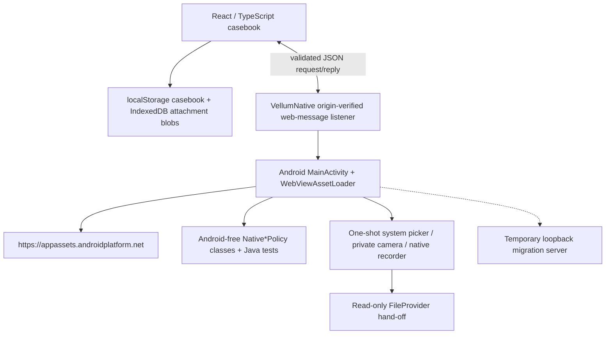

# Vellum Android architecture and privacy review

**Current code recheck: 2026-11-01.** This is a source and build-configuration review, not a device test, runtime network capture, or penetration test. Historical findings superseded by later work are identified below.

## Current architecture

- The web casebook stores its versioned state in localStorage key `vellum-casebook-v1` (`CASEBOOK_SCHEMA_VERSION = 4`) and attachment blobs in IndexedDB `vellum` (`ATTACHMENTS_SCHEMA_VERSION = 2`). Live data is not encrypted by the app at rest.
- The packaged page is served by `WebViewAssetLoader` at the trusted HTTPS origin. The APK build sets `VITE_GROK_EXTENSIONS=0` and runs `android/check-web-assets.py` over packaged assets. `INTERNET` and cleartext traffic remain for the one-time loopback migration flow only; no runtime network capture is represented here.
- `MainActivity` owns Android picker, camera, recorder, save, open-file and OCR flows. The custom APK build is `android/build-apk.sh`; the manifest/build currently target min SDK 24 and target SDK 35, with version `1.8` / versionCode `9`.

## Native/web boundary

`VellumNative` is installed using `WebViewCompat.addWebMessageListener` for the exact trusted origin. Requests must come from the main frame and trusted origin, use a non-empty ID of at most 96 characters, pass `isActionAllowed`, and use validated payloads. Reply IDs are one-shot while in flight. Migration-write operations are restricted to the trusted migration page.

Current trusted-page actions:

- `stopRecorder`, `cancelRecorder`
- `armRestorePicker`, `armAttachmentPicker`
- `readList`
- `beginSave`, `writeChunk`, `finishSave`
- `beginOpenFile`, `writeOpenChunk`, `finishOpenFile`, `cancelOpenFile`
- `migrationStatus`, `beginLegacyMigration`, `migrationArchiveInfo`, `readMigrationChunk`, `completeMigration`

Trusted migration-page-only actions are `beginMigrationArchive`, `writeMigrationChunk`, `finishMigrationArchive`, and `cancelMigration`.

The old `VellumBridge`/`addJavascriptInterface` API, `requestCamera` action, WebView microphone arm/grant actions, and old page-side chunked-file callbacks are removed. `onPermissionRequest` unconditionally denies page microphone/camera requests. Voice recording is performed by native `VoiceRecorder`; `NativeRecorderPolicy.canStart` and its session state prevent a second native recorder from starting while one is already active. The old `NativeAudioPermissionPolicy` is removed.

Native camera and recorder status is sent only through fixed scripts selected from the respective policy's allow-list, and only to the trusted page. The camera callback is `window.__vellumCameraStatus`; the recorder callback is `window.__vellumRecorderStatus`. No filenames, file data, or patient text are inserted into these scripts. Unknown status values are rejected and never sent.

## Native policies and file lifecycle

The policy classes are Android-free and have plain Java tests registered in `android/test-security-hardening.sh`:

| Policy | Responsibility |
|---|---|
| `NativeOriginPolicy` | Trusted HTTPS origin |
| `NativeAttachmentPolicy` | Attachment MIME/extension, byte-size, and count limits |
| `NativeAttachmentPickerPolicy` | Allowed picker purposes and one-shot 10-second arm |
| `NativeRestorePickerPolicy` | Restore-purpose, filename, and archive-size checks |
| `NativeSavePolicy` | Safe save filename and MIME |
| `NativeOpenPolicy` | External-view MIME, bounded sequential transfer (30 MiB ceiling), neutral name and cleanup |
| `NativeCameraPolicy` | Camera status/permission outcomes, decode scaling, JPEG quality steps and stale-file age |
| `NativeRecorderPolicy` | Recorder exclusivity, duration/size/header checks, file-path rules and status codes |
| `NativeWebAssetMime` | MIME types for packaged WebView assets |

`armAttachmentPicker` accepts only `files`, `photos`, `camera`, or `recorder`, plus a bounded item count (the camera-only `shrink` flag is validated separately). The WebView file chooser consumes that arm once. When there is no arm, the existing legacy `ACTION_GET_CONTENT` fallback remains; its initial intents are gallery and camera only, not the removed system recorder.

The non-exported `VellumFileProvider` exposes only these cache subdirectories:

| Cache path | Use and cleanup |
|---|---|
| `cache/open/` | Neutral, read-only copy for an external viewer. Old copies are removed at app start, on resume, before another hand-off, and on destroy. |
| `cache/camera/` | Private camera capture/processing files with a temporary write grant to the selected camera app. All are swept at start and destroy; stale files are swept on resume. |
| `cache/voice/` | Neutral `.m4a` recordings delivered to the page. A handed-off file is removed after page read/cancel/error; stale files are swept on resume and all files on start/destroy, except an active or held recording. |

The manifest declares `CAMERA`, `INTERNET`, and `RECORD_AUDIO`. Camera and microphone permissions are requested only at point of use. There is no foreground service. The launcher activity is exported for its launcher intent; the FileProvider is not exported. `FLAG_SECURE` remains enabled. Android backup is disabled with `allowBackup="false"` and backup/data-extraction rules exclude `root`, `file`, `database`, `sharedpref`, and `external`.

## Attachments, picker, camera, and recorder

- Attachment limits remain 4 MiB per file, 8 files per record, and 180 seconds for recordings. The web and native allow-lists are kept aligned. A missing attachment from a data-only restore is displayed as **Not restored** with its metadata and fingerprint; it has no blob to preview, can be removed, and its index fingerprint is preserved by later data-only backups.
- Files uses Android's document picker; Photos uses the platform photo picker where available and an image-only fallback on older versions. Camera and voice recorder use the shared picker-purpose path. The default unarmed chooser remains a fallback, not the primary menu path.
- Camera capture is photo-only and app-private. `NativeCameraPolicy` supplies the 2560-pixel long-edge bound and JPEG quality steps. The camera status callback uses fixed, allow-listed scripts.
- Voice capture uses `MediaRecorder` AAC in MPEG-4 (`.m4a`), mono 44.1 kHz / 64 kbps, with a 180-second ceiling, 3 MiB file ceiling, and approximately one-second minimum. It runs only in the foreground; `onPause` and audio-focus loss stop it. A stopped/held recording is delivered on return when the page callback is still available.
- The single attachment-row opener handles images, playable audio, text preview, Not restored and external hand-off. AMR/3GPP formats do not show the inline WebView player and require an explicit open-in-another-app action. `NativeOpenPolicy` copies approved bytes into `cache/open/` and launches `ACTION_VIEW` with a read-only grant. The chooser can report a refusal/no-app outcome; it does not persist the file grant.
- Manifest package-visibility `ACTION_VIEW` entries remain for PDF, image, audio and plain text so the external hand-off can resolve on Android 11+.

## Backup, restore, and orphan protection

- The **Back up data** flow produces an encrypted `VELLUMD1` archive containing the casebook data plus an attachment index, but no attachment bytes. It uses PBKDF2-SHA-256 (120,000 iterations) and AES-GCM. Index entries for Not restored files retain their stored fingerprints.
- The existing encrypted full archive uses `VELLUM1` and can carry attachment bytes. Plaintext CSV remains an explicit, warned export option. Backup files are saved through the system document picker; the app does not use external storage as private patient-data storage.
- Restore decrypts/parses before confirmation, builds restored records and any blobs off to the side, applies the attachment index, then invokes one casebook replacement. Failure before that swap cleans temporary blobs and leaves the existing casebook unchanged.
- `withRestoreInProgress` and a restore epoch guard the orphan-blob sweep. A sweep that overlaps restore or observes a changed restore epoch aborts before deleting blobs needed by the restore.

## Superseded implementation and review status

| Earlier description or finding | Current status |
|---|---|
| Loopback HTTP served the normal WebView page | Superseded by `WebViewAssetLoader` and the trusted HTTPS asset origin. Loopback remains only for migration. |
| A broad `VellumBridge` was exposed with `addJavascriptInterface` | Superseded; the origin-verified message listener is the only bridge. |
| Page microphone capture was armed and granted through `NativeAudioPermissionPolicy` | Superseded; that policy/actions/grant path are deleted and every WebView permission request is denied. |
| `requestCamera` and the system `RECORD_SOUND_ACTION` entry were used by the legacy bridge/chooser | Superseded; the shared one-shot picker handles camera/recorder, and the fallback chooser has no recorder intent. |
| Picked attachments were streamed back with `__vellumFileStart/Chunk/Done` | Superseded; there are no such page hooks or native bridge methods. `writeChunk` remains only for the active save flow. |
| Camera files were written to MediaStore, Android backup was enabled, or screen capture was unprotected | Superseded by private cache + non-exported provider, backup exclusions, and `FLAG_SECURE`. |

## Remaining review notes and limits

- Live patient data in localStorage/IndexedDB has no app-level at-rest encryption, and no app lock was found.
- The bundled ML Kit/OCR and OpenNLP models run in the native layer. Source inspection found no app-level OCR upload path, but no runtime network capture or airplane-mode device test was performed.
- `android/build-apk.sh` is a custom direct SDK build, not a Gradle/CI release pipeline. A production signing configuration was not reviewed.
- The casebook schema is versioned (`CASEBOOK_SCHEMA_VERSION = 4`; IndexedDB schema version 2) and rejects newer casebook data; this source review does not validate all OEM storage failure modes.
- No device penetration test, device/OEM behavior review, or runtime network capture was performed for this update.
