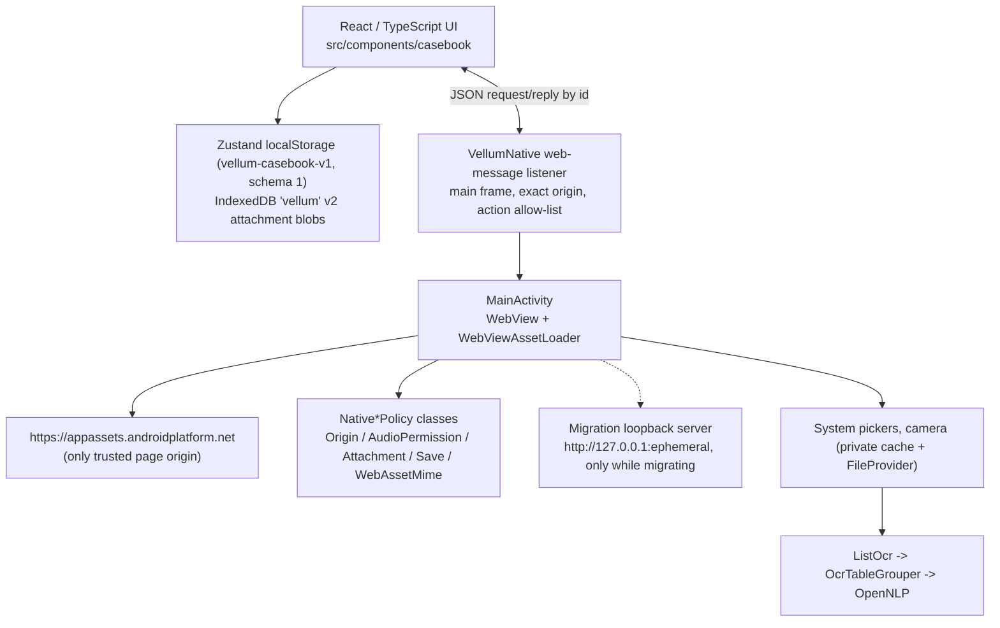
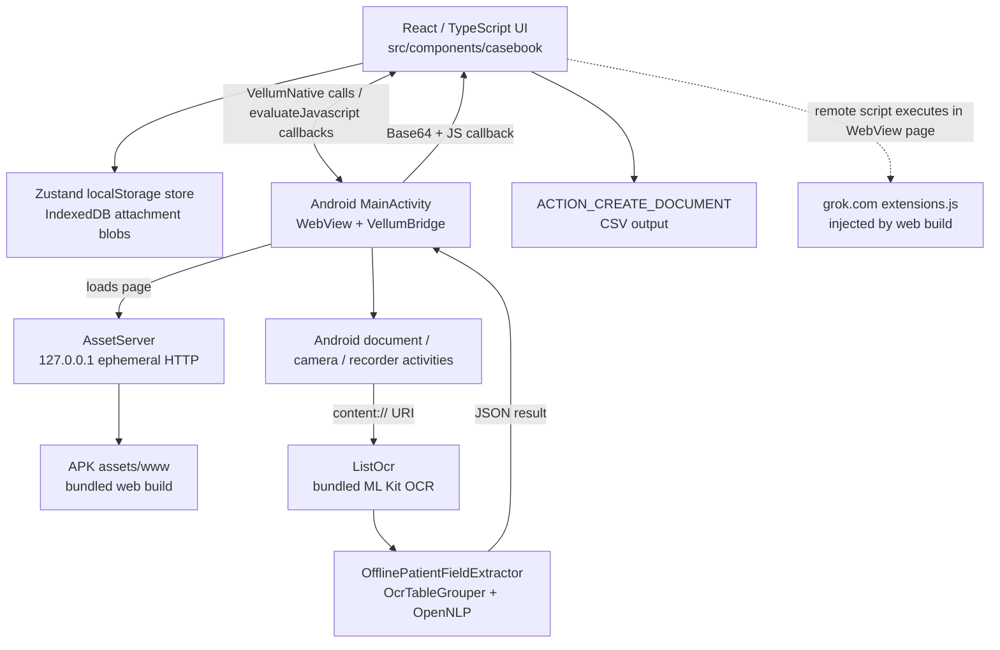

# Vellum Android architecture and privacy review

**Scope:** Read-only review of the Android app (`com.vellum.casebook`) and its bundled web UI. Findings describe repository evidence, not runtime network captures or a device penetration test. Each finding is marked **CONFIRMED** when the cited code/config demonstrates it, or **NOT FOUND** when the control or implementation was not found in the reviewed repository. A NOT FOUND result is not proof about device/platform behavior.

> **Status update (re-checked against the code on `offline-transcription`, 2026-10-25).** This review was written before the `security-hardening` work landed. Findings below are annotated with a **Status** line. **SUPERSEDED** means the described behaviour no longer exists in the code; **PARTLY SUPERSEDED** means it changed but a residual gap remains; **STILL OPEN** means the finding still applies. The original text is kept for history. This is a source re-read, not a device test or runtime network capture.
>
> | # | Finding | Status now |
> |---|---|---|
> | 1 | Remote script in WebView | **PARTLY SUPERSEDED**: APK build sets `VITE_GROK_EXTENSIONS=0` and `check-web-assets.py` fails the build on remote scripts/styles/imports. Non-APK web builds still inject it by default. |
> | 2 | No at-rest encryption | **STILL OPEN** |
> | 3 | Bridge without origin check | **SUPERSEDED** |
> | 4 | Mic grant not tied to origin/gesture | **SUPERSEDED** (residual: no single-owner mic arbitration) |
> | 5 | Cleartext + INTERNET | **PARTLY SUPERSEDED**: page is HTTPS on the asset origin; `INTERNET` and `usesCleartextTraffic="true"` remain for the migration loopback server |
> | 6 | Permissive WebView policy | **PARTLY SUPERSEDED**: content access remains enabled by design |
> | 7 | Backup / screen capture / app lock | **PARTLY SUPERSEDED**: backup and `FLAG_SECURE` done; no app lock found |
> | 8 | Camera into MediaStore | **SUPERSEDED**: captures go to app-private cache via a non-exported FileProvider |
> | 9 | Plaintext CSV | **PARTLY SUPERSEDED**: encrypted export exists and plaintext export has a confirmation step (wording not re-reviewed) |
> | 10 | Unbounded attachment buffering | **PARTLY SUPERSEDED**: type/size/count enforced by `NativeAttachmentPolicy` (4 MiB, 8 files); whether intermediate copies remain was not re-audited |
> | 11 | OcrTableGrouper tests | **STILL OPEN** |
> | 12 | Hand-maintained build | **STILL OPEN** |
> | 13 | Partial schema versioning | **PARTLY SUPERSEDED**: casebook envelope has a version (1) with `migrateStoredCasebook` that rejects newer versions; IndexedDB schema is v2; migration tests exist; no multi-step migration history yet |
> | 14 | Bundle size | **STILL OPEN** (current `artifacts/Vellum.apk` is 17,277,518 bytes) |

**Restore picker correction:** The Archive restore input uses a trusted-page, one-shot native picker arm and a separate `ACTION_OPEN_DOCUMENT` path. Native restore validation allows only `.vellum` and `.csv` names with a verified nonzero size up to 64 MiB; attachment validation remains governed by `NativeAttachmentPolicy`. No URI permission is persisted.

## Architecture map

> **SUPERSEDED diagram.** The diagram below shows the earlier design (loopback `AssetServer` page origin, remote script). The current design is the next diagram.

Current (as of this update):

Historical (superseded):

### Modules and packages

- **Android shell:** `com.vellum.casebook` Java classes in `android/src/com/vellum/casebook/`. `MainActivity` owns the WebView, picker flows, JavaScript bridge, permission handling, exports and OCR orchestration. `AssetServer` serves packaged web assets over loopback. OCR/data classes include `ListOcr`, `OcrDocument`, `OcrTableGrouper`, `OfflinePatientFieldExtractor`, `OpenNlpNameFinder`, and result/value classes. Evidence: `android/src/com/vellum/casebook/MainActivity.java:36-58`, `android/src/com/vellum/casebook/AssetServer.java:16-34`, `android/src/com/vellum/casebook/ListOcr.java:24-45`.
- **Web layer:** React/TypeScript casebook UI (`src/components/casebook/`), Zustand patient/contact persistence (`src/lib/casebook/store.ts`), IndexedDB attachment storage (`src/lib/casebook/files.ts`), and the native-facing list-import UI (`src/components/casebook/list-sheet.tsx`). The root route renders the casebook directly (`src/routes/index.tsx:4-8`).
- **Native/web boundary:** Android loads the APK's `assets/www` page at `http://127.0.0.1:<ephemeral-port>/`. JavaScript invokes methods on `window.VellumNative`; native results are passed back using `evaluateJavascript`, including OCR JSON encoded as Base64 (`android/src/com/vellum/casebook/MainActivity.java:74-104`, `305-313`, `526-675`). File selection, capture, microphone use and saving are native-intent operations; OCR and extraction execute in Java.
- **Android build:** No Gradle wrapper, Gradle build file, or Android CI workflow was found. `android/build-apk.sh` directly invokes Android Build Tools 35.0.0, `aapt2`, `javac` and D8; it packages Java/native libraries and web assets itself (`android/build-apk.sh:1-23`, `145-221`). Manifest SDK levels are `minSdkVersion 24` and `targetSdkVersion 35` as supplied to `aapt2` (`android/build-apk.sh:5-6`, `163-168`). D8 dexing is used; no R8 or minification step was found (`android/build-apk.sh:158-164`). The checked-in build script signs its APK with a generated local debug keystore (`android/build-apk.sh:207-220`); a production upload-key configuration was **NOT FOUND**. The workspace's generated `artifacts/Vellum.aab` is signed with a temporary self-signed test key, not a Play upload key.

## Prioritized findings

### Critical

> **Status: PARTLY SUPERSEDED.** `android/build-apk.sh` exports `VITE_GROK_EXTENSIONS=0` and runs `android/check-web-assets.py` over the packaged `assets/www`; `test-security-hardening.py` asserts both. Residual: preview/Vercel builds still inject the script by default, and this review did not inspect a built APK's `index.html` in this pass.

1. **Remote mutable JavaScript runs inside the patient-data WebView — CONFIRMED.** The web build injects `https://grok.com/grok-app-builder/extensions.js` by default; only setting `VITE_GROK_EXTENSIONS=0` disables the injection (`scripts/grok-pwa-shared.mjs:203`, `210-212`, `235-248`). The Android APK build copies preview-produced HTML into the app (`android/build-apk.sh:9`, `15-21`), and the Android documentation confirms the built page contains that script (`android/README.md:18-24`). The WebView enables JavaScript and exposes the native bridge (`android/src/com/vellum/casebook/MainActivity.java:68-75`); patient records live in the page's localStorage (`src/lib/casebook/store.ts:292-296`), attachments in IndexedDB (`src/lib/casebook/files.ts:35-44`, `67-76`), and OCR output is delivered into page JavaScript (`android/src/com/vellum/casebook/MainActivity.java:305-313`, `316-332`). The extension script itself is not in the repository, so its behavior and any resources it loads are **NOT FOUND / not verifiable**; no exfiltration is asserted.
   - **Recommended fix:** Remove the remote script from the Android build output; bundle and audit all app code/resources locally. Prefer an Android-specific build that omits platform-injected web chrome instead of relying on a mutable flag. Validate the final APK's HTML and network behavior in an offline test.
   - **Effort:** S

### High

> **Status of 2: STILL OPEN.** No Keystore/biometric/keyguard use found in `android/src`.
>
> **Status of 3: SUPERSEDED.** `MainActivity` uses `WebViewCompat.addWebMessageListener("VellumNative", {"https://appassets.androidplatform.net"}, …)`; messages are dropped unless `isMainFrame` and `isTrustedBridgeOrigin`; every action passes `isActionAllowed` (trusted page, or trusted migration page for migration writes); request ids are capped at 96 chars; `NativeSavePolicy` restricts save filenames/MIME (`.csv`/`.vellum`), chunks are capped (48 KiB) and total save size is capped (64 MiB). `addJavascriptInterface` is absent (asserted by test). An unused `VellumBridge` inner class remains in the source.
>
> **Status of 4: SUPERSEDED.** `NativeAudioPermissionPolicy.canGrant` requires HTTPS, host `appassets.androidplatform.net`, port 443/default, `RECORD_AUDIO` granted, capture armed by a native request, arm not expired (10 s) and exactly one resource `AUDIO_CAPTURE`. `onPause` clears the arm. Residual: no single-owner arbitration between audio consumers, and the web `RecordButton` that uses this path is not mounted anywhere.

2. **Live patient data and attachments are stored without app-level encryption — CONFIRMED.** Patient/contact JSON is persisted through Zustand's `localStorage` backend (`src/lib/casebook/store.ts:18`, `292-296`, `303-329`); attachment blobs are stored as-is in IndexedDB (`src/lib/casebook/files.ts:35-44`, `67-76`). No encryption or Android Keystore use for these live stores was found. The separate optional archive export uses PBKDF2/AES-GCM (`src/lib/casebook/archive.ts:378-429`); it does not encrypt the live casebook.
   - **Recommended fix:** Decide the required at-rest threat model before choosing a storage redesign. For meaningful protection while the app is locked/not in use, move live sensitive data to app-private native storage encrypted with a key protected by Android Keystore; introduce authenticated app lock/biometric unlock and a tested migration from current WebView storage. Do not claim the current browser stores are encrypted.
   - **Effort:** L

3. **JavaScript bridge has no caller-origin check or method-level trust boundary — CONFIRMED.** `VellumBridge` exposes `requestMicrophone`, `requestCamera`, `openCamera`, `readList`, `openAttach`, `openFiles`, `openRecorder`, `beginSave(filename, mime)`, `writeChunk(base64)`, and `finishSave` (`android/src/com/vellum/casebook/MainActivity.java:526-675`). No method verifies the calling frame/origin; `addJavascriptInterface` installs it on the WebView (`MainActivity.java:74-75`). `beginSave` accepts supplied filename/MIME values with only null/empty defaults (`MainActivity.java:632-649`); `writeChunk` decodes arbitrary-size chunks into an in-memory buffer without a cumulative size limit (`MainActivity.java:651-663`). These methods invoke system UI and/or use user-granted URIs, so repository evidence does not establish silent access to arbitrary files.
   - **Recommended fix:** Replace the broad bridge with narrowly scoped, origin-verified message handling (e.g. WebView message listener with exact origin allowlist) and only expose capabilities needed for an explicit user action. Validate filename/MIME, cap total buffered bytes, reject malformed or out-of-sequence save operations, and test cross-origin/frame calls.
   - **Effort:** L

4. **Microphone capture grant is not tied to a trusted origin or an app-level user gesture — CONFIRMED.** A WebView audio permission request is granted when Android's `RECORD_AUDIO` permission is already granted; the callback checks the requested audio resource but not the request origin (`android/src/com/vellum/casebook/MainActivity.java:264-279`). The JavaScript bridge can request the Android permission (`MainActivity.java:527-542`), and the web recorder calls `getUserMedia({ audio: true })` (`src/components/casebook/record.tsx:89-108`). Once the OS permission has been approved, page JavaScript can request WebView audio capture without a second native user-gesture check. Actual unauthorized recording was **NOT FOUND / not demonstrated**.
   - **Recommended fix:** Gate WebView permission requests on the exact trusted local origin, require a user-initiated recording state in native code, and revoke/deny requests outside that state. Remove microphone permission and recorder functionality if not required.
   - **Effort:** M

5. **Cleartext networking and broad network permission remain enabled — CONFIRMED.** The manifest grants `INTERNET` and sets application-wide `android:usesCleartextTraffic="true"` (`android/AndroidManifest.xml:7`, `43-50`). The native page is served over loopback HTTP (`android/src/com/vellum/casebook/AssetServer.java:26-34`; `MainActivity.java:101-104`), and the web build also includes the remote HTTPS extension above. No external cleartext request was confirmed in the reviewed source; runtime network activity is **NOT FOUND / not measured**.
   - **Recommended fix:** Remove remote loads first. Replace the loopback HTTP server with `WebViewAssetLoader` and an HTTPS app-assets origin; then remove `INTERNET` if the app has no remaining network feature and remove the global cleartext exception. If any network feature is intentionally retained, document and constrain it.
   - **Effort:** M

> **Status of 5: PARTLY SUPERSEDED.** The page no longer loads from a loopback HTTP server (`WebViewAssetLoader`, HTTPS asset origin). The manifest still declares `INTERNET` and `usesCleartextTraffic="true"`; the remaining consumer is the one-time migration flow (`migrationServer`, `http://127.0.0.1:<port>`, trusted only while a migration is active). No other network feature was found. Removing the permission depends on retiring that flow.

### Medium

> **Status of 6: PARTLY SUPERSEDED.** Now set explicitly: file access off (incl. file-URL access), mixed content `NEVER_ALLOW`, WebView debugging off, exact origin via `NativeOriginPolicy`, navigation allow-list (non-trusted URLs open externally), `shouldInterceptRequest` blocks other requests with 403. `setAllowContentAccess(true)` remains for user-selected attachment URIs.
>
> **Status of 7: PARTLY SUPERSEDED.** `allowBackup="false"` plus `backup_rules.xml` and `data_extraction_rules.xml` excluding `root`, `file`, `database`, `sharedpref`, `external` (cloud-backup and device-transfer); `FLAG_SECURE` set in `onCreate`; tests assert all of this. No app lock/biometric gate found.
>
> **Status of 8: SUPERSEDED.** Camera output is created under `getCacheDir()/camera` and shared through the non-exported `VellumFileProvider` (`file_paths.xml` exposes only `cache-path camera/`); `dropCameraOutput` cleans up. `MediaStore` is still used to let the user pick gallery images (read), not to store captures.
>
> **Status of 9: PARTLY SUPERSEDED.** `ArchiveSheet` offers a CSV export (with a plaintext warning step, `warnPlain`) and a password-encrypted archive. CSV still contains identifiers in the clear if the user chooses it.
>
> **Status of 10: PARTLY SUPERSEDED.** `NativeAttachmentPolicy` enforces allowed type, 1 to 8 files and ≤ 4 MiB per file, and the read loop aborts when the total exceeds the cap.
>
> **Status of 11: STILL OPEN.** No `OcrTableGrouper` test file exists in `android/test`.

6. **WebView access/navigation policy is permissive and does not enforce one exact local origin — CONFIRMED.** JavaScript, DOM storage, file access, content access and database storage are enabled (`android/src/com/vellum/casebook/MainActivity.java:68-75`). The navigation handler opens non-local HTTP(S) links externally but allows `localhost` and `127.0.0.1` links to remain in the WebView (`MainActivity.java:682-710`); it does not pin the expected scheme, ephemeral port, or asset path. The bridge has no origin check (finding 3). Explicit settings for mixed-content mode and WebView remote debugging were **NOT FOUND** in the app source; the code does not call `setWebContentsDebuggingEnabled`.
   - **Recommended fix:** Use `WebViewAssetLoader` with a fixed HTTPS origin, disable file/content access unless a demonstrated feature needs them, explicitly set mixed content to never allow, and enforce an exact navigation allowlist. Keep WebView debugging disabled in release builds.
   - **Effort:** M

7. **Backup, screen capture protection and app lock are not configured — NOT FOUND.** The manifest does not specify `android:allowBackup`, `dataExtractionRules` or `fullBackupContent` (`android/AndroidManifest.xml:43-50`). No `FLAG_SECURE` setup was found in `MainActivity` (`android/src/com/vellum/casebook/MainActivity.java:64-106`), and the home route renders the casebook without an app-lock gate (`src/routes/index.tsx:4-8`; `src/lib/auth/provider.tsx:13-14`). Actual device backup behavior is platform-dependent and was not verified.
   - **Recommended fix:** Explicitly opt out of cloud/device backup for patient data (or narrowly exclude sensitive stores), set `FLAG_SECURE` if screenshots/recents previews are outside the intended workflow, and add an authenticated lock/biometric gate aligned with the storage encryption model.
   - **Effort:** M

8. **Camera captures are created in shared MediaStore before being consumed — CONFIRMED.** Camera output is inserted into `MediaStore.Images.Media.EXTERNAL_CONTENT_URI` (`android/src/com/vellum/casebook/MainActivity.java:237-253`). Successful capture results are passed to the web layer (`MainActivity.java:737-745`). Whether a particular device/provider syncs that image is **NOT FOUND / device-dependent**.
   - **Recommended fix:** Capture into app-private cache using a non-exported `FileProvider` URI with temporary grants; delete temporary images after consumption/cancellation. Retain shared MediaStore only if the product explicitly wants captures saved to the user's gallery.
   - **Effort:** M

9. **CSV export writes patient identifiers in plaintext to a user-selected destination — CONFIRMED.** The exported CSV includes patient name, date of birth, gender, phone and email (`src/components/casebook/list-sheet.tsx:129-143`). Native saving uses `ACTION_CREATE_DOCUMENT` (`android/src/com/vellum/casebook/MainActivity.java:632-649`); the chosen destination can be a cloud-backed provider, though actual upload is **NOT FOUND / provider-dependent**. The separate encrypted archive is optional, not the default CSV path.
   - **Recommended fix:** Make the sensitivity and destination explicit in the UI; offer encrypted export as the default/required workflow for sensitive data, and avoid retaining URI grants unless required. Confirm whether unencrypted CSV export is an intended clinical workflow.
   - **Effort:** M

10. **Image and attachment ingestion can buffer large files in memory — CONFIRMED.** The native attachment path reads an entire selected URI into a `ByteArrayOutputStream` and then copies it to a byte array before chunking it to JavaScript (`android/src/com/vellum/casebook/MainActivity.java:352-380`). No native size cap was found on that path. PDF OCR is capped at six pages and each rendered page at three million pixels, with the bitmap recycled after processing (`android/src/com/vellum/casebook/ListOcr.java:55-77`, `105-116`); image OCR uses a content URI directly (`ListOcr.java:32-44`).
    - **Recommended fix:** Enforce file size/type limits before reading, stream bounded chunks instead of keeping multiple full copies, and fail with a clear UI error when limits are exceeded.
    - **Effort:** M

11. **OCR/extraction coverage exists, but row grouping lacks isolated tests — CONFIRMED.** The extraction test harness runs 13 synthetic scenarios and compiles `OcrTableGrouper` as part of the extractor path (`android/test/com/vellum/casebook/PatientFieldExtractorTest.java:25-39`; `android/test-extraction.sh:10-22`). No dedicated `OcrTableGrouper` test file or native `ListOcr` instrumentation test was found. Thus grouping is exercised indirectly, while Android OCR/resource lifecycle and device behavior are not covered by this test suite.
    - **Recommended fix:** Add focused geometry/ordering/null-bounds/group-boundary tests for `OcrTableGrouper`, and device/instrumentation or adapter tests for image/PDF resource cleanup and OCR failure cases.
    - **Effort:** M

### Low

> **Status of 12: STILL OPEN.** Still `javac`/D8/`aapt2` scripts, debug keystore, no CI.
>
> **Status of 13: PARTLY SUPERSEDED.** `CASEBOOK_SCHEMA_VERSION = 1` in the `vellum-casebook-v1` envelope; `migrateStoredCasebook` accepts version 0/1 and throws on newer versions; IndexedDB has a `metadata.schemaVersion` (v2) with `upgradeAttachmentDatabase`; `migration.test.ts`, `casebook-storage.test.ts` and `files.test.ts` exist. App `versionCode` is 9 / `versionName` 1.8.
>
> **Status of 14: STILL OPEN.**

12. **Android build and release process is hand-maintained rather than a reproducible Gradle/CI build — CONFIRMED.** The native build is a shell script with hard-coded Build Tools/API 35 paths (`android/build-apk.sh:3-6`) and manually packages classes, assets and native libraries (`android/build-apk.sh:145-205`). It signs using a generated debug keystore and fixed debug passwords (`android/build-apk.sh:207-220`). No Gradle build files/wrapper or `.github` CI workflows were found. The app currently uses Java rather than Kotlin; no DI framework or native data-access abstraction was found (`MainActivity` owns the Android orchestration; the web store is Zustand/IndexedDB).
    - **Recommended fix:** Establish a reproducible release build with pinned Android Gradle Plugin/SDK/tooling, release signing via protected CI secrets or Play App Signing, artifact verification, and CI tests. Modularize the activity and introduce a small repository/data boundary before expanding features. Kotlin migration is optional; it is not itself a security fix.
    - **Effort:** L

13. **Local data schema versioning is only partial — CONFIRMED.** The casebook uses a `vellum-casebook-v1` localStorage key and normalization/bootstrap logic (`src/lib/casebook/store.ts:18`, `303-329`); the attachments database is opened at IndexedDB version 1 (`src/lib/casebook/files.ts:3-4`, `35-44`). No explicit versioned localStorage migration framework was found. Android app metadata is `versionCode=9`, `versionName=1.8` (`android/AndroidManifest.xml:2-5`).
    - **Recommended fix:** Define explicit data schema versions and forward migrations for both patient records and attachments; test upgrade, interruption, rollback/recovery, and export before changing storage.
    - **Effort:** M

14. **App bundle size is driven by bundled OCR native code and the person model; no delivery optimization is configured — CONFIRMED.** The packaged native OCR libraries are approximately 11 MB (`arm64-v8a`) and 6.5 MB (`armeabi-v7a`), and the OpenNLP model is approximately 5 MB (`android/third_party/opennlp/assets/opennlp/en-ner-person.bin`). The current custom build copies both ABI libraries into the APK (`android/build-apk.sh:182-190`); the resulting APK is about 17 MB. No ABI split or Play Feature Delivery configuration was found. The OCR API uses ML Kit's bundled/thick-client recognizer (`android/src/com/vellum/casebook/ListOcr.java:32-44`; `android/README.md:18`).
    - **Recommended fix:** If Play distribution is planned, evaluate AAB ABI targeting/splits first; it can avoid delivering both native ABIs to one device. Consider install-time/on-demand feature delivery for OCR only if delayed availability is acceptable. Unbundled ML Kit may reduce initial size but downloads a model and conflicts with a strict offline-first requirement; measure that tradeoff before switching. Review dependency/model updates and verify licenses (the repository itself flags the OpenNLP model redistribution terms as needing confirmation: `android/README.md:31-33`).
    - **Effort:** M

## Additional confirmed/not-found checks

> **Updates:** the "no FileProvider" and "no mixed-content / WebView-debugging setting" statements below are **SUPERSEDED** (a non-exported `VellumFileProvider` exists; mixed content and debugging are set explicitly). The microphone bullet's line references are **SUPERSEDED** (see status of finding 4). No `android.util.Log` use was found anywhere in `android/src` on re-check.

- **Runtime camera and microphone permissions:** **CONFIRMED.** Runtime permission requests and result handling are implemented for camera and microphone (`android/src/com/vellum/casebook/MainActivity.java:527-561`, `807-835`). Camera is used for capture (`MainActivity.java:237-253`). Microphone is used by the web recorder (`src/components/casebook/record.tsx:89-108`), so removing `RECORD_AUDIO` requires removing or redesigning that feature.
- **Manifest components:** **CONFIRMED.** The launcher activity is exported and has a MAIN/LAUNCHER intent filter (`android/AndroidManifest.xml:53-64`). The ML Kit provider is explicitly non-exported; its discovery service is also non-exported (`AndroidManifest.xml:65-77`). No other app activity, service or FileProvider declaration was found in the manifest. No explicit `android:debuggable` attribute was found; its effective value in the custom packaging flow was not verified on a device.
- **PII in logs:** **NOT FOUND.** No patient/OCR content logging was found in the inspected production path (`android/src/com/vellum/casebook/MainActivity.java:316-345`; `android/README.md:18-24`). This is a repository source review, not runtime log capture.
- **Other remote resources:** The source/build configuration directly identifies the injected `grok.com` script (`scripts/grok-pwa-shared.mjs:203-248`). No other direct remote resource URL was identified in the app shell sources searched. The remote script is not present to inspect, and its runtime requests cannot be enumerated from this repository; therefore “no other runtime remote loads” is **NOT FOUND / unverified**, not a guarantee.
- **Mixed content and WebView debugging:** Explicit app configuration was **NOT FOUND**. No mixed-content override or `setWebContentsDebuggingEnabled` call appears in `MainActivity`; actual WebView defaults/device state were not dynamically tested.
- **Play Store readiness:** A production signing key and release signing configuration were **NOT FOUND**. The generated bundle artifact in this workspace is signed with a temporary test key and must not be treated as a Play upload artifact.

## Proposed remediation plan

> **Progress:** steps 1 (APK path), 2 (fixed HTTPS origin, origin-verified messaging, exact allow-list) and the backup/camera parts of 4 and 5 are done. Open: remove `INTERNET`/cleartext (blocked on the migration flow), encrypted live storage and app lock, `OcrTableGrouper` tests, reproducible Gradle/CI/release signing, and delivery-size optimisation.

1. **Remove remote code from Android-delivered HTML** and verify the packaged `assets/www/index.html` and a runtime network capture contain no remote scripts/resources.
2. **Close the WebView/native boundary:** move to a fixed HTTPS asset origin, exact navigation allowlist, origin-verified messaging, and capability-specific bridge methods; gate audio behind explicit native recording state.
3. **Reduce network surface:** replace `AssetServer` loopback HTTP with `WebViewAssetLoader`; disable file/content access where feasible; explicitly prohibit mixed content; remove `INTERNET` and cleartext if no networking remains.
4. **Protect data at rest and in use:** agree on biometric/app-lock requirements, migrate live patient and attachment storage to an encrypted native data layer backed by Android Keystore, and define backup exclusions and screenshot/recents policy.
5. **Harden file flows:** move temporary camera images to app-private storage, bound file and bridge buffers, make plaintext exports explicit or require encrypted export, and test cancellation/cleanup.
6. **Add verification:** isolated `OcrTableGrouper` tests, OCR lifecycle/instrumentation tests, offline network checks, WebView bridge/origin tests, and migration tests.
7. **Make releases reproducible:** adopt a pinned Gradle/AAB build, release signing/Play App Signing, CI checks, ABI targeting, and an explicit policy for bundled versus delivered OCR models.

**Awaiting approval:** Which numbered findings or remediation steps would you like implemented? No code changes have been made as part of this review.
